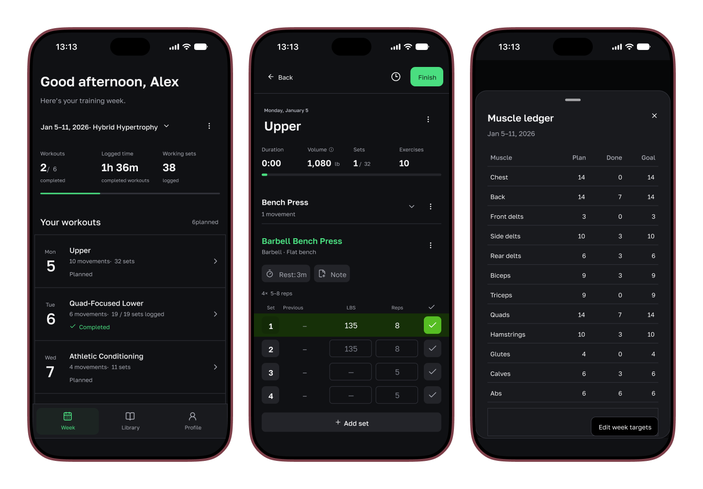
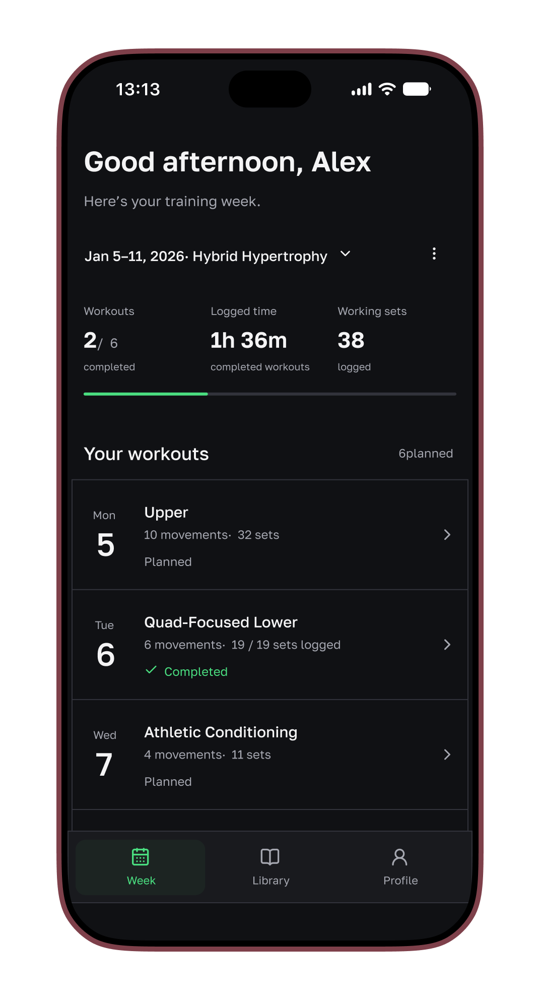
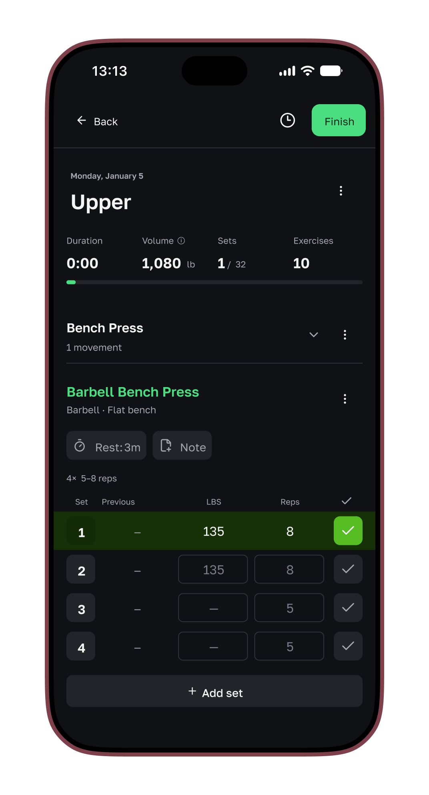
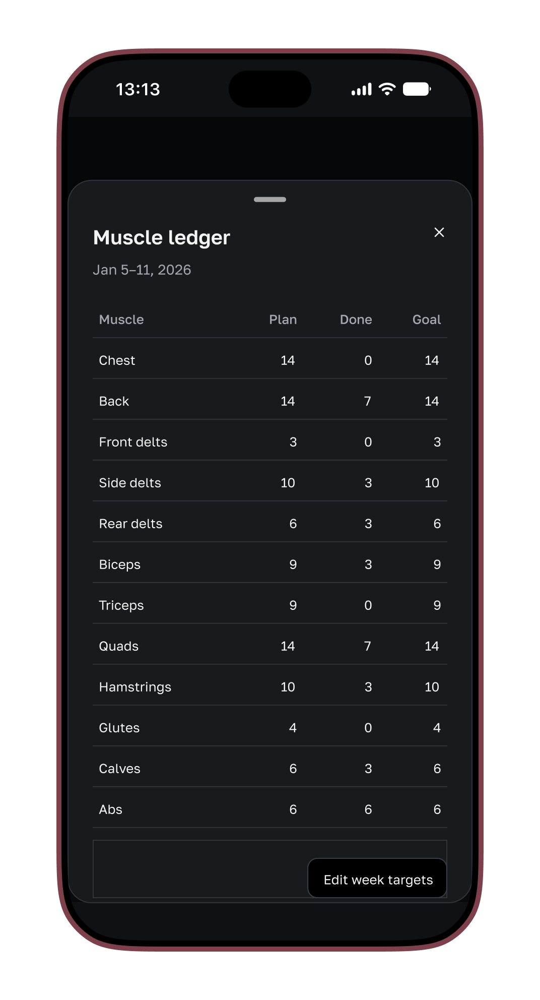
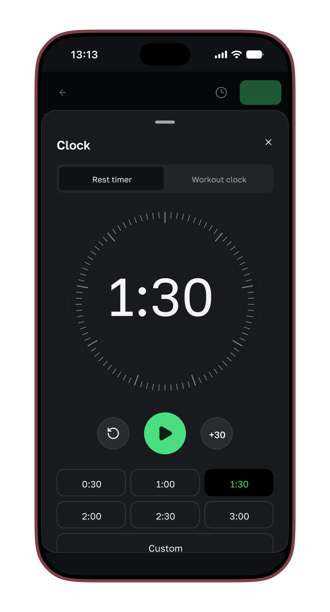

# Training Log: Open-Source Workout Tracker with API Access

A free, open-source, headless-first workout tracker with structured training data and an API for your own tools and AI agents.

Plan your training week, record sets on your phone, and compare what you completed with your muscle-volume targets. Your exercise library, prescriptions, and performed results live in one data model, so you can use the app in the gym and connect your own tools to organize what comes next.

[Get Started](#getting-started) · [User Guide](docs/user-guide.md) · [Agent Integration](docs/agent-integration.md)



## Features

### Workout Planning

Build dated workouts from reusable routines, organize movements into groups, and prescribe individual sets with reps, weight, time, distance, and rest settings. Repeat a week without copying its completed results, then adjust the next plan while keeping your training history intact.

### Workout Logging

See previous performance alongside your current targets. Enter what you actually did, check off finished sets, and adjust movements as your workout changes. Warm-up, normal, failure, and drop sets have distinct labels. Notes, extra sets, and corrections stay with the workout they describe.

Changes save automatically. Previously opened workouts remain available for offline logging, with device-stored changes synchronized when connectivity returns.

### Muscle Ledger

Set weekly working-set targets for each muscle group, then compare **Plan**, **Done**, and **Goal** in one muscle ledger. See where your planned week falls short of a target and how much of that work you actually completed.

Each eligible working set credits one primary muscle. Warm-ups are excluded, and secondary muscles remain descriptive rather than adding extra credits. Reusable goals carry into new weeks, while week-specific targets preserve the intent of earlier plans. Your own agent can read the same ledger to help adjust upcoming workouts.

Workout summaries also show duration, completed sets, and recorded weight volume. Prescriptions remain separate from actual results, so planning a workout never counts as performing it.

### Timers

Keep the workout clock and rest countdown close to your set log. Choose presets or a custom duration, enable automatic rest for individual movements, and use countdown sounds or optional device notifications. Notification delivery requires connectivity and supported device settings.

| Workout Planning | Workout Logging |
|---|---|
|  |  |

| Muscle Ledger | Rest Timer |
|---|---|
|  |  |

[Editable Figma mockups and image credits](docs/images/README.md)

## API and AI Access

Give your own agent access to the same structured records the app uses. For example, it can read comparable exercise history, review weekly muscle volume, repeat a training week, and update prescriptions through the API. You choose the tools and authorize their access.

Named, revocable keys separate reading, planning, library maintenance, and result updates. Revision checks and idempotent writes help integrations handle concurrent changes and uncertain connections. The [agent integration guide](docs/agent-integration.md), [OpenAPI specification](public/openapi.json), and [TypeScript declarations](contracts/api.d.ts) provide the integration contract.

The app does not include an AI coach or MCP server. Its HTTP API is the foundation for connecting your own agents, scripts, or additional clients. JSON backups, additive imports, and CSV result exports keep your records portable.

## Getting Started

Run your own instance with Node 24, Docker Desktop, and npm:

```sh
npm ci
npm run setup:local
npm run db:up
npm run db:migrate
npm run owner:bootstrap
npm run dev -- --hostname 127.0.0.1
```

Open `http://localhost:3000`. Your generated local login is in `.local/login.txt`. Setup preserves an existing environment, and local credentials stay outside Git.

Start with an empty library or import the [Hybrid Hypertrophy example](examples/hybrid-hypertrophy.json) through Profile. It contains synthetic prescriptions and no performed results. Repeat its sample week onto your chosen Monday to try the planning workflow.

See [Self-Hosting](docs/self-hosting.md) for persistent storage and deployment. Each installation currently supports one privately provisioned owner. Public signup is disabled.

## About the Project

Training Log began as a personal alternative inspired by Hevy, shaped around the planning, logging, and data access I wanted for my own training. I wanted to organize the underlying records clearly enough that both a practical phone interface and my own AI tools could work with them.

The project is free and open source under the [MIT license](LICENSE). The goal is to share a useful, adaptable foundation. You can run it for yourself, change the client, or build on its API.

The web app uses Next.js, React, and shadcn/ui, with PostgreSQL, Drizzle, and Better Auth underneath. It is an early working prototype with automated tests, and has not received an independent security audit. Read [Security](SECURITY.md) before exposing an installation.

For more detail, see the [architecture](docs/technical-design.md), [training model](docs/training-model.md), and [contribution guide](CONTRIBUTING.md). Personal workouts, private exports, and credentials are excluded from this repository.
